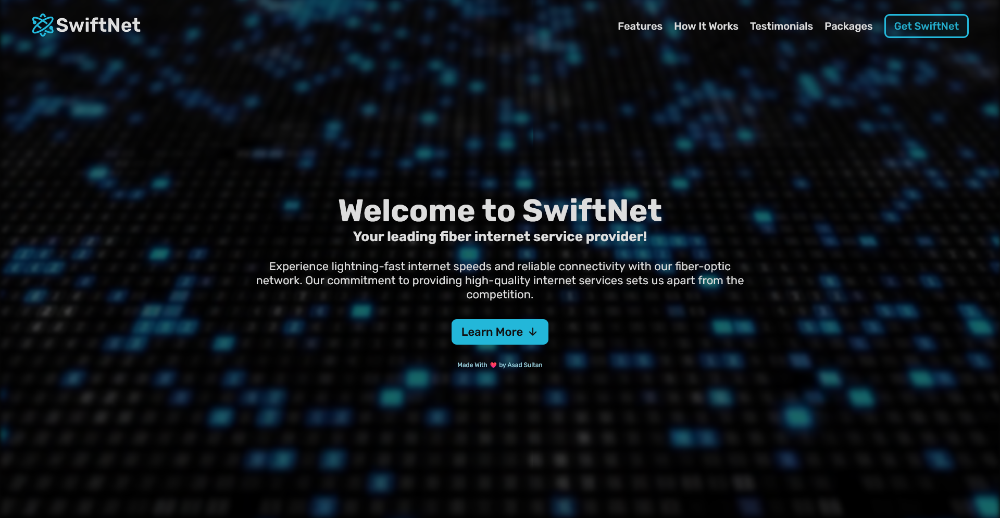

# SwiftNet: Internet Provider Landing Page

A responsive-style marketing landing page for **SwiftNet**, a fictional internet service provider, built with HTML, CSS and a little JavaScript.

**[Live demo](https://swiftnet.netlify.app/)**



## Sections

- Hero with a looping video background
- Featured-in logos
- Features
- How it works
- Customer testimonials
- Pricing: four plans (Bronze, Silver, Gold, Platinum)
- Sign-up form with plan selection
- Footer with navigation columns

## Highlights

- Sticky navigation bar that appears after scrolling past the hero, using the Intersection Observer API
- Layout with CSS Grid and Flexbox
- Hover and transition effects on navigation and buttons
- Footer year updated automatically with JavaScript

## Tech stack

HTML5 · CSS3 · Vanilla JavaScript · Google Fonts (Rubik) · [Ionicons](https://ionic.io/ionicons)

## Running locally

Clone the repo and open `index.html` in a browser. An internet connection is needed for fonts and icons.

## Project structure

```
index.html
css/style.css
js/script.js
img/               # logos, testimonials, backgrounds
hero-bg/           # hero video and poster
```

## Credits

Built while following HTML & CSS Course by Jonas Schmedtmann and adapted with my own branding and content.
